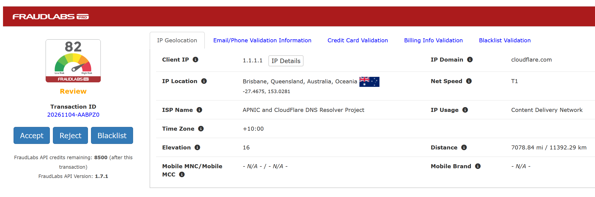

# ZenCart: FraudLabs Pro™ Credit Card Fraud Prevention v1.8.0

## Overview

This plugin screens online transactions, especially credit card orders, for potential fraud. It helps minimize the risk of accepting fraudulent orders while allowing legitimate customers to shop without valid orders being rejected.

The plugin returns a fraud indicator and comprehensive validation results for each online order, so store owners can decide whether to proceed with or reject an order. It also lets store owners customize the validation logic with their own fraud-checking rules based on their business needs. Inevitably, this helps minimize fraud and chargeback losses and improve business profits.

Find out more at [https://www.fraudlabspro.com](https://www.fraudlabspro.com). You can sign up for a free account at [https://www.fraudlabspro.com/sign-up](https://www.fraudlabspro.com/sign-up?r=zencart) to start using this feature. (Paid options provide more features and higher API limits, but they are not required — the module works with the free license.)

## Installation

> **Note:** In this document, "server" means the location where ZenCart is installed, and *admin* refers to the ZenCart admin folder, which is renamed during installation.
>
> This solution requires ZenCart 2.0 or later and PHP 8. It has been tested on ZenCart 2.0.1, 2.1.0 and 2.2.x. Compatibility with earlier ZenCart and PHP versions is not guaranteed.
>
> **IMPORTANT:** Back up your ZenCart source files before proceeding.

### Step 1: Upload the plugin

1. Unzip the package to a folder on your desktop.
2. Upload the `zc_plugins/FraudLabsPro` folder to the `zc_plugins` directory in the root of your ZenCart installation. The result should be `zc_plugins/FraudLabsPro/1.8.0/`.

### Step 2: Install from Plugin Manager

1. Go to **Admin → Modules → Plugin Manager**.
2. Find **FraudLabs Pro** in the list and click **Install**. The installer creates the `orders_fraudlabspro` table and the configuration settings automatically. No SQL patch and no core-file edit are required.
3. After installation the plugin is enabled. Use **Disable** to stop screening while keeping your settings and stored results, or **Uninstall** to remove the settings and drop the table.

### Step 3: Get a free FraudLabs Pro license key

1. You need a FraudLabs Pro license key. You can register a free key at [https://www.fraudlabspro.com/sign-up](https://www.fraudlabspro.com/sign-up) if you do not have one.
2. Go to **Admin → Tools → FraudLabs Pro**.
3. Find **License Key** and enter your license key.
4. **You do NOT need a callback URL.** The module calls the FraudLabs Pro servers when needed.

**IP Override (testing)** — enter an IPv4 or IPv6 address to send that address to FraudLabs Pro instead of the visitor's actual IP. The real address is still stored with the order. Leave this empty in production; it is only meant for testing and debugging.

### Step 4: Done

1. You have successfully completed the installation.
2. You can start customizing your fraud-checking rules at [https://www.fraudlabspro.com](https://www.fraudlabspro.com) and protect your business from unwanted fraud attempts.
3. If you want to enable the [Agent JavaScript](https://www.fraudlabspro.com/developer/javascript) feature, you can do so from **Admin → Tools → FraudLabs Pro**.

## Updating from an unencapsulated version

Earlier releases were installed by copying files into `includes/` and the admin folder. Remove those files before installing the plugin, otherwise they will also be loaded:

- `includes/classes/fraudlabspro/`
- `includes/classes/observers/auto.fraudlabspro_process.php`
- `includes/extra_datafiles/flp_orders.php`
- `includes/modules/fraudlabspro/` (the old `fraudlabspro.php`)
- `includes/modules/pages/checkout_process/header_php.php` (restore the original ZenCart file, which removes the `require(DIR_WS_MODULES . 'fraudlabspro/fraudlabspro.php')` line)
- `includes/modules/pages/checkout_confirmation/jscript_fraudlabspro.php`
- `admin/includes/classes/observers/auto.fraudlabspro_admin_order.php`
- `admin/includes/classes/observers/auto.fraudlabspro_order_delete.php`
- `admin/includes/classes/observers/auto.zcObserverFraudlabsProOrderDelete.php` (only present in 1.5.x packages)
- `admin/includes/extra_datafiles/flp_orders.php`
- `admin/includes/languages/english/extra_definitions/lang.fraudlabspro.php`
- `admin/includes/modules/fraudlabspro/`
- Remove the `include(DIR_WS_MODULES . 'fraudlabspro/summary.php')` line from `admin/orders.php` if an earlier version added it.

Your existing results are kept. The installer detects the previous table and upgrades its columns to the current schema. If you are coming from 1.4.x, run `alter_flp_orders.sql` once with **Tools → Install SQL Patches** before installing the plugin.

The root-level SQL files are only needed for manual installs: `flp_orders.sql` creates the table and settings, and `alter_flp_orders.sql` is only needed when upgrading from 1.4.x before installing the plugin.

---

Copyright © 2026 [FraudLabs Pro](https://www.fraudlabspro.com). All Rights Reserved.
